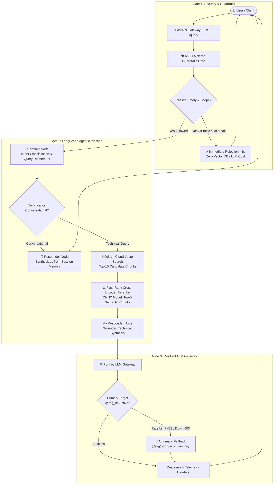
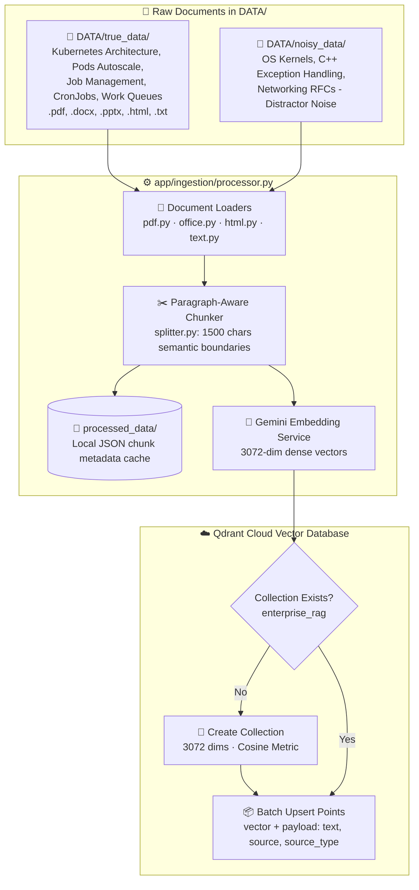
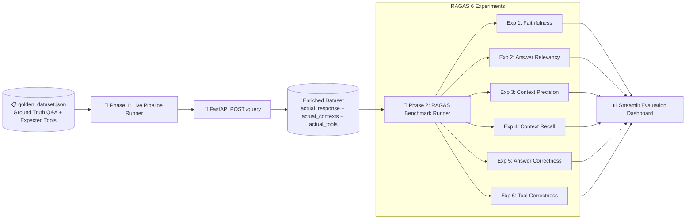

# ☸️ KubeMind: Enterprise Agentic RAG & Copilot for Kubernetes

[](https://www.python.org/)
[](https://fastapi.tiangolo.com/)
[](https://github.com/langchain-ai/langgraph)
[](https://qdrant.tech/)
[](https://github.com/NVIDIA/NeMo-Guardrails)
[](https://portkey.ai/)
[](https://github.com/explodinggradients/ragas)
[](https://www.docker.com/)

**KubeMind** is a production-grade, security-hardened **Enterprise Agentic Retrieval-Augmented Generation (RAG) System** purpose-built for Kubernetes cluster engineering, enterprise networking, and cloud-native infrastructure troubleshooting.

Unlike typical demo RAG applications that connect a basic prompt directly to an LLM, KubeMind implements an **autonomous agent state machine** with pre-retrieval **NVIDIA NeMo security guardrails**, **two-stage semantic reranking**, **Portkey LLM Gateway failover**, and a **built-in continuous evaluation suite**.

---

## 🏛️ System Architecture

### 1. End-to-End Query Lifecycle

Every incoming query passes through a multi-stage security, planning, retrieval, and synthesis pipeline:



---

### 2. Multi-Format Data Ingestion & Vector Indexing Pipeline

Before the RAG system can answer queries, raw documents in `DATA/` are parsed, chunked, vectorized, and indexed into **Qdrant Cloud**:



---

### 3. Evaluation Suite Architecture (LLM-as-a-Judge)

KubeMind includes an independent **Streamlit Evaluation Dashboard** (`evals/app.py`) powered by **RAGAS** and **OpenAI `gpt-4o-mini`**:



---

## ⚡ Key Engineering Decisions & Trade-Offs

| Decision | What We Built | Why This Matters in Enterprise Production |
| :--- | :--- | :--- |
| **Multi-Format Ingestion** | Native loaders for PDF, DOCX, PPTX, HTML, and TXT | Enterprise documentation is scattered across slide decks, SOP word files, and web docs. The pipeline unifies them into a single schema. |
| **Pre-Retrieval Guardrails** | **NVIDIA NeMo Guardrails** with Colang rules | Blocks adversarial prompts (jailbreaks) and off-topic queries in **<1 second** before any database search, saving up to 80% in compute and token costs. |
| **Resilient LLM Gateway** | **Portkey Gateway** (`pc-enterp-f26518`) with automated fallback (`@rag_8h` $\rightarrow$ `@rag1-8h`) | Production systems cannot crash due to vendor rate limits (`429`) or outages (`503`). Portkey automatically retries and routes requests to a secondary key without downtime. |
| **Two-Stage Retrieval** | **Qdrant Cloud** (top-15) + **FlashRank Cross-Encoder** (top-5) | Dense vector search (cosine similarity) is mathematically fuzzy. FlashRank rescores candidate passages using a quantized Cross-Encoder ONNX model locally in <0.15s for high precision. |
| **Agentic State Machine** | **LangGraph** with Planner & Responder nodes | Traditional linear RAG chains are fragile. LangGraph enables cyclic decision-making: conversational memory queries bypass the vector database entirely, while technical queries undergo automated query refinement. |
| **Distributed Tracing** | **Pydantic Logfire** (OpenTelemetry) | Provides complete visibility into internal latencies across NeMo guardrails, planner decisions, Qdrant retrieval, and LLM token generation. |
| **Continuous Benchmarking** | **RAGAS Evaluation Suite** using `gpt-4o-mini` as an LLM judge | Quantitative metrics validate model performance against ground truth datasets to detect regressions before deployment. |

---

## 📂 Project Directory Structure

```text
k8s-enterprise-agentic-rag/
├── DATA/                                  # Raw enterprise multi-format documents
│   ├── true_data/                         # Ground truth K8s docs (.pptx, .docx, .html, .txt)
│   └── noisy_data/                        # Distractor technical papers & RFCs for noise benchmarks
├── processed_data/                        # Cached JSON chunk metadata & payloads
│   ├── true/
│   └── noisy/
├── app/
│   ├── agents/
│   │   ├── graph.py                       # LangGraph cyclic state machine definition
│   │   ├── state.py                       # AgentState schema (messages, docs, plan)
│   │   └── nodes/
│   │       ├── planner.py                 # Intent classification & query refinement
│   │       ├── retriever.py               # Qdrant search + FlashRank reranking coordinator
│   │       └── responder.py               # Grounded technical response generation
│   ├── gateway/
│   │   └── client.py                      # Portkey client, slug routing, fallback targets
│   ├── guardrails/
│   │   ├── colang_rules.py                # Colang flows for jailbreak & off-topic policies
│   │   └── rails.py                       # NeMo LLMRails gatekeeper singleton
│   ├── ingestion/                         # Universal document ingestion engine
│   │   ├── chunking/
│   │   │   └── splitter.py                # Paragraph-aware semantic text chunker (1500 chars)
│   │   ├── loaders/                       # Format-specific document parsers
│   │   │   ├── pdf.py                     # PDF text extractor (pypdf / PyMuPDF)
│   │   │   ├── office.py                  # DOCX & PPTX extractors (python-docx, python-pptx)
│   │   │   ├── html.py                    # HTML parser (BeautifulSoup4)
│   │   │   └── text.py                    # Plain text loader
│   │   └── processor.py                   # Main ingestion runner (parse → chunk → embed → Qdrant)
│   ├── services/
│   │   └── retrieval/
│   │       ├── embeddings.py              # Gemini 3072-dim dense embedding service
│   │       ├── qdrant_service.py          # Qdrant Cloud client & vector query logic
│   │       └── ranking_service.py         # FlashRank Cross-Encoder ONNX reranker
│   ├── config.py                          # Pydantic environment configuration
│   └── main.py                            # FastAPI application, routes, and Logfire setup
├── evals/
│   ├── app.py                             # Streamlit Evaluation Suite UI
│   ├── golden_dataset.json                # Ground truth questions, contexts, and answers
│   ├── guardrails_eval.py                 # Binary confusion matrix (TP/TN/FP/FN) evaluator
│   ├── metrics.py                         # RAGAS 6-experiment evaluation execution engine
│   └── pipeline.py                        # Live pipeline runner against running FastAPI backend
├── ui/
│   └── app.py                             # Streamlit Chatbot UI for end users
├── Dockerfile                             # Production-hardened container specification
├── .dockerignore                          # Docker build exclusion rules
├── .gitignore                             # Git exclusion rules
├── .env.example                           # Environment variable template
└── requirements.txt                       # Pinned Python package dependencies
```

---

## 🚀 Quickstart & Setup Guide

### 1. Prerequisites
* **Python 3.11+**
* **Git**
* Free API Keys:
  * **Groq API Key** (LLM inference)
  * **Qdrant Cloud API Key & URL** (Vector database)
  * **Google Gemini API Key** (Embeddings)
  * **Portkey API Key** (Gateway & Fallback)
  * **OpenAI API Key** (Required for RAGAS evaluation judge `gpt-4o-mini`)
  * **Logfire Token** (Telemetry & tracing)

---

### 2. Installation

Clone the repository and set up a Python virtual environment:

```bash
# Clone the repository
git clone https://github.com/zainsardar0/k8s-enterprise-agentic-rag.git
cd k8s-enterprise-agentic-rag

# Create and activate virtual environment
python -m venv .venv

# On Windows (PowerShell):
.\.venv\Scripts\Activate.ps1

# On Linux / macOS:
source .venv/bin/activate

# Install dependencies (using uv for high-speed installation or standard pip)
pip install -r requirements.txt
```

---

### 3. Environment Configuration

Copy the `.env.example` file to `.env`:

```bash
cp .env.example .env
```

Open `.env` and fill in your API credentials:

```env
# Primary and Fallback Groq Keys
GROQ_API_KEY=gsk_your_primary_key
GROQ_FALLBACK_API_KEY=gsk_your_fallback_key
JUDGE_GROQ=gsk_your_judge_key

# Qdrant Vector Cloud
QDRANT_API_KEY=your_qdrant_key
QDRANT_CLUSTER_ENDPOINT=https://your-cluster-url.qdrant.io

# Embedding Model (Gemini)
GEMINI_API_KEY=your_gemini_key

# Portkey Gateway
PORTKEY_API_KEY=your_portkey_key
GROQ_SLUG=rag_8h
GROQ_SLUG_2=rag1-8h

# Evaluation Suite Judge (OpenAI)
OPENAI_API_KEY=sk-proj-your_openai_key

# Observability (Logfire)
LOGFIRE_TOKEN=your_logfire_token
```

---

### 4. Ingest Documents into Qdrant Cloud (Mandatory First Step)

> [!IMPORTANT]
> **You must run ingestion before starting the backend or running evaluations.**  
> The repository includes raw Kubernetes architecture docs and noise benchmarks under `DATA/`. The ingestion engine parses these files, breaks them into 1500-character semantic chunks, generates 3072-dimensional vector embeddings with Google Gemini, and uploads them with source metadata to your Qdrant Cloud cluster.

Run the ingestion processor across the dataset:

```bash
# Ingest all documents from DATA/ (auto-detects true_data and noisy_data subdirectories):
python -m app.ingestion.processor DATA
```

#### Ingestion Options & Flags:

* **Clean Fresh Ingestion (`--wipe`)**:  
  Drops the existing Qdrant collection, recreates it with 3072-dim Cosine metrics, and re-indexes all documents:
  ```bash
  python -m app.ingestion.processor DATA --wipe
  ```

* **Ingest Only Kubernetes Ground Truth Data**:
  ```bash
  python -m app.ingestion.processor DATA/true_data true
  ```

* **Ingest Only Distractor Noise Data**:
  ```bash
  python -m app.ingestion.processor DATA/noisy_data noisy
  ```

Once ingestion completes, you will see confirmation logs in your terminal and Logfire:  
`✅ Generated chunks → Vectorizing & Indexing → Indexed points to Qdrant → Ingestion job completed.`

---

### 5. Running the Application

Open separate terminal windows for the backend and user interfaces:

#### A. Start the FastAPI Backend
```bash
uvicorn app.main:app --reload --port 8000
```
* **API Documentation (Swagger UI):** `http://localhost:8000/docs`
* **Health Check:** `http://localhost:8000/health`

#### B. Start the User Chatbot Dashboard
```bash
streamlit run ui/app.py
```
* Access the interactive chat interface at `http://localhost:8501`.

#### C. Start the RAGAS Evaluation Suite
```bash
streamlit run evals/app.py --server.port 8502
```
* Access the Evaluation Suite at `http://localhost:8502`.

---

## 📊 Evaluation Benchmark Suite

The evaluation suite runs **6 rigorous experiments** against the ground truth dataset:

| # | Metric | Evaluator | What It Measures | Target |
| :-: | :--- | :--- | :--- | :-: |
| **1** | **Faithfulness** | RAGAS (`gpt-4o-mini`) | Verifies that all generated statements are derived strictly from retrieved context (zero hallucination). | $\ge 0.85$ |
| **2** | **Answer Relevancy** | RAGAS (`gpt-4o-mini`) | Measures how directly the response addresses the prompt without extraneous fluff. | $\ge 0.85$ |
| **3** | **Context Precision** | RAGAS (`gpt-4o-mini`) | Measures the signal-to-noise ratio of the retrieved chunks (relevant chunks ranked first). | $\ge 0.80$ |
| **4** | **Context Recall** | RAGAS (`gpt-4o-mini`) | Verifies that all ground-truth facts were successfully retrieved by the search engine. | $\ge 0.80$ |
| **5** | **Answer Correctness** | RAGAS (`gpt-4o-mini`) | Assesses factual and semantic similarity against human ground truth reference answers. | $\ge 0.80$ |
| **6** | **Tool Correctness** | Jaccard Similarity (Code) | Verifies that the agent selected the appropriate tool (`retrieve_documents` vs `direct_answer`). | $1.00$ |

### Conservative Rate-Limit Buffer Design
To guarantee stable, error-free benchmark runs without triggering API rate limits:
* **`DELAY_BETWEEN_CALLS = 10s`**: 10-second buffer between live RAG queries to respect Groq RPM quotas.
* **`COOLDOWN_MINI = 40s`**: 40-second buffer between sample evaluations to avoid OpenAI token bursts.
* **`COOLDOWN_STANDARD = 62s`**: 62-second cooldown between major experiments allowing OpenAI's 1-minute sliding window to reset.
* **`CONTEXT_TRUNCATE = 1500 chars`**: Supplies complete evidence passages to the evaluation judge for reliable scoring.

---

## 🐳 Docker Deployment

The repository includes a production-hardened, multi-layer Dockerfile:

```bash
# 1. Build the production Docker image
docker build -t kubemind-rag:latest .

# 2. Run the container with environment variables
docker run -d \
  --name kubemind \
  -p 8080:8080 \
  --env-file .env \
  kubemind-rag:latest

# 3. Verify health
curl -f http://localhost:8080/docs
```

---

## 🛡️ License

This project is licensed under the **Apache 2.0 License**.
